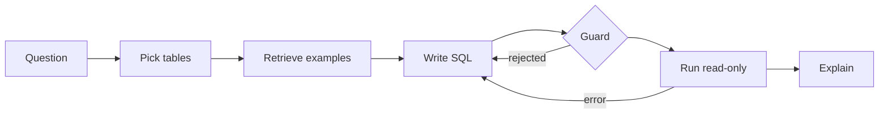

# Project plan: TalkToData SQL assistant

## Goal

A public, zero-cost text-to-SQL assistant over a dummy HR & payroll database that a non-technical user can open from a link, ask questions in plain English, and get correct, explained, charted answers, with the SQL always visible.

Success means: a live demo link, 80%+ execution accuracy on the 50-question benchmark with at least one free model, all tests green in CI, and a README a recruiter understands in one minute.

## Principles

1. **Safe by design**: the database can never be changed, whatever the model writes.
2. **Measured, not claimed**: every accuracy statement comes from `eval/run_eval.py`.
3. **Model-agnostic**: switching provider is one line in `.env`.
4. **Dummy data only**: nothing from a real employer, client or person.
5. **Explainable**: every answer shows its SQL and the steps the agent took.

## Architecture

| Layer | Choice | Why |
|---|---|---|
| Orchestration | LangGraph | Explicit steps and a retry loop, easy to test and explain |
| LLM | Groq / Gemini free tiers, Ollama local, Claude optional | Free to run; swappable via `src/llm_factory.py` |
| Database | SQLite | One file, generated on start, no server |
| Data | Faker with fixed seed | Realistic and identical on every machine |
| Example retrieval | TF-IDF (scikit-learn) | Free, instant, no model download; neural embeddings later |
| SQL safety | sqlglot parser + read-only connection | Does not rely on the model behaving |
| UI | Streamlit | Chat UI in one file, free hosting |
| Tests / CI | pytest + GitHub Actions | Fake LLM makes tests free and offline |

## Phases

| Phase | Deliverable | Done when |
|---|---|---|
| 0. Setup | Repo, venv, requirements, `.env`, `CLAUDE.md` | Repo on GitHub, installs cleanly |
| 1. Data | Generator, schema docs, glossary | 10 hand-written queries return sensible numbers |
| 2. Core | LLM factory, schema prompt, SQL guard, DB runner | Guard tests pass; easy questions answered |
| 3. Agent | LangGraph flow, examples, retries, follow-ups | Errors self-correct, follow-ups work |
| 4. UI | Streamlit chat, charts, SQL view, CSV | A non-technical person uses it unaided |
| 5. Ship | Eval, CI, README, deploy | 80%+ accuracy, public link works |
| 6. Stretch | MCP server, Postgres/Azure SQL, role-based columns, caching | Pick 1–2 that match target roles |

**Status (Nov 2026):** phases 0–4 done and verified; phase 5: benchmark run and tuned (78–84% across clean runs, see README), CI runs lint + type-check + tests; GitHub publish and public deploy still to do. Phase 6: MCP server done.

## Risks and how they are handled

| Risk | Handling |
|---|---|
| Model writes harmful SQL | Parser allows only one SELECT; connection is read-only |
| Model invents columns | Real schema in prompt; DB error feeds back for a fix |
| Wrong business logic (e.g. attrition) | Glossary rules in every prompt; examples show correct patterns |
| Free-tier rate limits | Session question limit; `--sleep` in eval; provider switch |
| Model retired by provider | Model name is a setting; defaults documented |
| Public demo abuse | Per-session question cap; no write access; small dataset |
| Eval leakage | Eval questions kept separate from few-shot examples |
