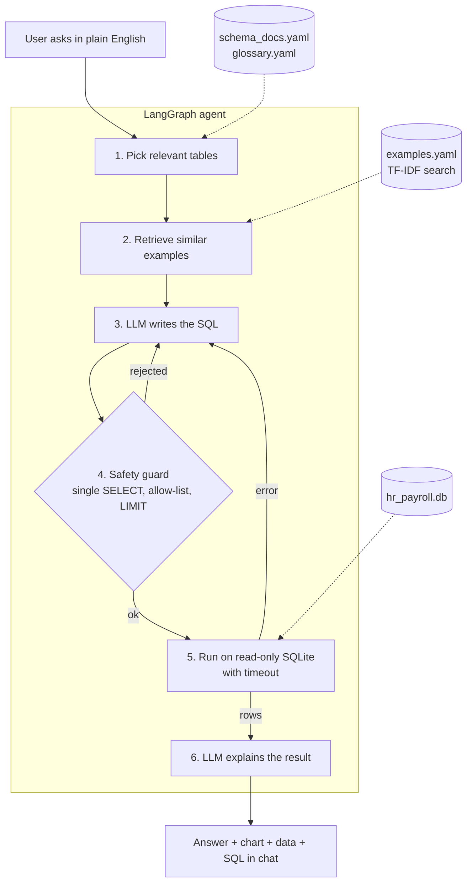

# TalkToData: chat with your HR & payroll data in plain English

Ask a question like *"Which open payroll exceptions are older than 14 days?"* and the assistant writes safe SQL, runs it on the database, and replies with a plain-English answer, a chart, the data, and the exact SQL it used.

Built with **Python, LangChain, LangGraph, SQLite and Streamlit**. Works with free LLMs (Groq, Google Gemini, or a local Ollama model) and with Claude. Total running cost: **$0**.

> **Live demo:** _add your Streamlit link here_ · **Video walkthrough:** _add your LinkedIn/YouTube link here_

<!-- Add a demo GIF: record 20–30 seconds of the app and save it as docs/demo.gif -->
<!--  -->

All data in this project is **fictional**: four made-up companies and ~635 made-up employees generated with Faker.

---

## Why this project

Business teams wait days for simple data answers because only analysts can write SQL. This assistant lets anyone ask in plain English, while staying **safe** (it can never change data), **transparent** (it always shows its SQL), and **measured** (it has a 50-question accuracy benchmark).

## What it does

- **Plain-English to SQL** with a LangGraph agent: picks the relevant tables, finds similar solved examples, writes the query, checks it, runs it, explains it
- **Self-correction**: if the SQL fails or is rejected, the error goes back to the model to fix (up to 3 tries)
- **Four safety layers**: read-only connection, SQL parser that allows only one `SELECT`, table allow-list, row limit + timeout
- **Business glossary** so "attrition", "headcount", "open exception" follow company definitions
- **Follow-up questions** ("now only for Cedarline Health") using conversation history
- **Auto charts**: KPI card, line chart for trends, bar chart for comparisons; CSV download
- **Swap the LLM with one setting**: Groq, Gemini, Ollama (local), Claude, NVIDIA
- **Evaluation**: execution accuracy on 50 questions (easy / medium / hard)
- **68 automated tests** run on every push with GitHub Actions

## How it works



The model is called 3 times for a normal question: pick tables, write SQL, explain the result. It only ever sees the schema, a few sample rows and the result of its own query, never the full tables.

## The dummy database

| Table | Rows | What it holds |
|---|---|---|
| companies | 4 | Brightwave Solutions, Cedarline Health, Northpeak Logistics, Orbitron Retail |
| departments | 24 | 6 departments per company with cost centers |
| employees | 635 | Hires, leavers, job levels, manager hierarchy, work state |
| salaries | 2,111 | Salary history: new hire, annual merit, promotion |
| payroll_runs | 23,891 | Two years of biweekly payroll (gross, tax, benefits, net, employer tax) |
| payroll_exceptions | 431 | Payroll issues with status and resolution dates |
| attendance | 35,186 | Daily attendance for the last 90 days |
| performance_reviews | 1,706 | Half-yearly ratings 1–5 |
| leave_balances | 1,506 | Annual, sick and personal leave balances |

The data has realistic problems planted in it (duplicate payments, overtime spikes, slow-to-resolve exceptions) so there are interesting things to find. "Today" in the data is **2026-10-31**, so answers never change with the real date.

## Quick start

```bash
git clone https://github.com/<your-username>/talk-to-data-sql-assistant.git
cd talk-to-data-sql-assistant
python -m venv .venv
# Windows: .venv\Scripts\activate     macOS/Linux: source .venv/bin/activate
pip install -r requirements.txt
copy .env.example .env               # macOS/Linux: cp .env.example .env
# open .env and paste your free GROQ_API_KEY (https://console.groq.com)
python data/generate_data.py
streamlit run app/streamlit_app.py
```

Full step-by-step guide for Windows and VS Code: [docs/HOW_TO_RUN.md](docs/HOW_TO_RUN.md).

## Accuracy

Run the benchmark yourself:

```bash
python eval/run_eval.py                    # uses LLM_PROVIDER from .env
python eval/run_eval.py --provider gemini  # compare another model
```

| Provider | Model | Execution accuracy | Easy | Medium | Hard | Avg retries | Avg seconds |
|---|---|---|---|---|---|---|---|
| _fill in from your run_ | | | | | | | |

*Execution accuracy* = the assistant's result table has the same values as a hand-written correct query (row order, column names and extra columns are ignored).

## Project structure

```
├── app/streamlit_app.py     chat interface
├── src/
│   ├── agent.py             LangGraph agent (the brain)
│   ├── sql_guard.py         safety checks on generated SQL
│   ├── db.py                read-only execution with timeout
│   ├── schema.py            schema + business docs for the prompt
│   ├── examples_store.py    finds similar example questions (TF-IDF)
│   ├── prompts.py           all prompt templates
│   ├── llm_factory.py       Groq / Gemini / Ollama / Claude / NVIDIA
│   ├── charts.py            picks the right chart
│   ├── mcp_server.py        read-only MCP tools for Claude Desktop
│   └── config.py            settings from .env
├── data/                    generator, schema docs, glossary, examples
├── eval/                    50 test questions + accuracy runner
├── tests/                   68 pytest tests (no API key needed)
└── docs/                    how-to, interview guide, LinkedIn kit
```

## Run the tests and quality checks

```bash
pip install -r requirements-dev.txt
ruff check .        # lint
mypy                # type-check
python -m pytest    # tests
```

Tests use a fake LLM with scripted replies, so they are free, fast and need no API key. CI runs all three on Python 3.11 and 3.13.

## Use it from Claude Desktop (MCP server)

`src/mcp_server.py` exposes the database to any MCP client through four read-only tools: `list_tables`, `describe_tables`, `business_rules` and `run_sql`. The client's own model writes the SQL, so no API key is needed, and every query passes the same guard and read-only connection as the chat app.

```bash
pip install -r requirements-mcp.txt
```

Then add this to Claude Desktop's config (**Settings → Developer → Edit Config**; on Windows the file is `%APPDATA%\Claude\claude_desktop_config.json`) and restart Claude Desktop:

```json
{
  "mcpServers": {
    "talktodata": {
      "command": "C:\\path\\to\\talk-to-data-sql-assistant\\.venv\\Scripts\\python.exe",
      "args": ["C:\\path\\to\\talk-to-data-sql-assistant\\src\\mcp_server.py"]
    }
  }
}
```

On macOS/Linux use `.venv/bin/python` and forward slashes. Ask Claude something like *"Using talktodata, which department had the most leavers in 2026?"*

## Deploy for free

1. Push this repo to GitHub.
2. Go to [share.streamlit.io](https://share.streamlit.io), choose the repo, main file `app/streamlit_app.py`.
3. In **Advanced settings → Secrets**, add `GROQ_API_KEY = "..."` and `LLM_PROVIDER = "groq"`.
4. Deploy. The database is generated automatically on first start.

## What I'd build next

- Role-based access (hide salary columns for some users)
- PostgreSQL / Azure SQL support
- Query result caching and cost tracking
- Neural embeddings for example search when the example set grows

## License

MIT. Data is fictional and generated; any resemblance to real companies or people is coincidental.
